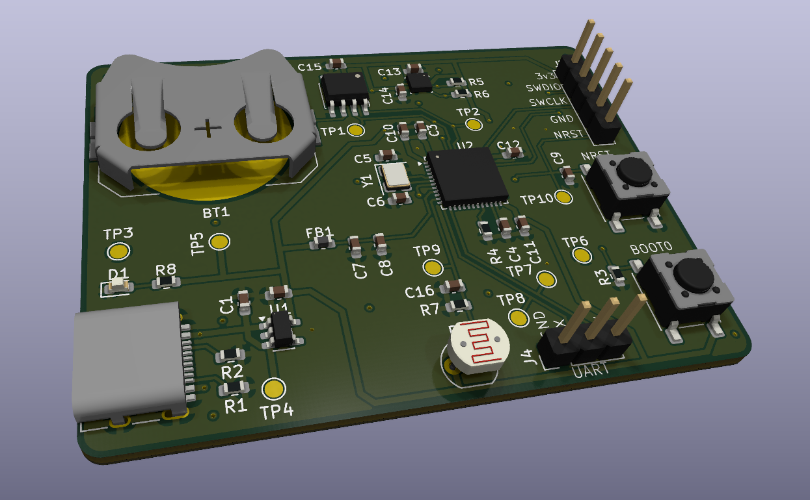

# Env Logger на STM32F401

Автономний логер параметрів середовища на **STM32F401CCU6**. Кожні *N* секунд система зчитує температуру, вологість і тиск (BME280), освітленість (фоторезистор GL5516) та час (DS3231), формує запис і асинхронно виводить його в UART-термінал. Збої шини I2C обробляються автоматично, а watchdog перезапускає систему, якщо вона зависне.

## Можливості

- Вимірювання T / H / P (BME280, I2C), мітка часу (DS3231, I2C), освітленість (GL5516, ADC1 + DMA)
- Інтервал опитування 1..3600 с, змінюється на ходу командою з терміналу
- Асинхронний вивід: кільцевий буфер + DMA (`printf` не блокує цикл)
- Консоль керування по UART RX (встановлення часу, інтервал, статус, скидання лічильника помилок)
- Відновлення після збоїв I2C: повтори, скидання шини, повторна ініціалізація датчиків
- Незалежний watchdog (IWDG) і журнал причини скидання
- Перевірка коректності даних і введення, захист від переповнення буферів

## Формат логу

```
[14:11:35] T:18.9 H:58.6 P:1004.5 LUX:19 ERR:0
```

| Поле | Значення |
|---|---|
| `[HH:MM:SS]` | час з DS3231 |
| `T` | температура, °C |
| `H` | відносна вологість, % |
| `P` | атмосферний тиск, гПа |
| `LUX` | освітленість, лк (`ERR`, якщо датчик відключений) |
| `ERR` | накопичений лічильник вичерпаних циклів помилок |

Службові повідомлення: `[WARN] retry N/3 ...`, `[ERR] ... bus recovery`, `Sensors: RTC OK, BME280 OK`, `Reset reason: ...`.

## Апаратна частина

| Компонент | Призначення |
|---|---|
| STM32F401CCU6 (Black Pill), кварц HSE 25 МГц | МК, 84 МГц |
| BME280 (I2C, 0x76) | температура, вологість, тиск |
| DS3231 (I2C, 0x68) | годинник реального часу |
| GL5516 + резистор 10 кОм | освітленість (дільник напруги) |
| USB-TTL адаптер CH340 | UART-термінал |
| Pull-up 10 кОм на SDA/SCL | підтяжка шини I2C |

Усі датчики живляться від **3.3 В**.

## Архітектура

Суперцикл (без RTOS) на основі станів і переривань. Код розділений на три шари:

| Шар | Модулі | Відповідальність |
|---|---|---|
| Periph | `uart_log`, `uart_rx`, `i2c_bus`, `ds3231`, `bme280`, `light` | робота з периферією та датчиками |
| Logic | `logger`, `log_entry`, `log_format`, `cli` | рішення: коли міряти, що записати, як реагувати на команду |
| Reliability | `watchdog`, `reset_info`, відновлення в `logger` і `i2c_bus` | захист від збоїв |

Залежності ідуть лише вниз: драйвери нічого не знають про логер.

### Чому не RTOS

Система виконує одну періодичну задачу (опитування раз на секунди) і консоль із низьким навантаженням. Весь доступ до I2C здійснюється з одного контексту (основний цикл), а спільні дані між ISR і циклом це 32-бітні прапори та лічильники й кільцеві буфери з одним виробником і одним споживачем. Тому гонки виключені за побудовою, і ні мьютекси, ні черги не потрібні. Додавання RTOS збільшило б обсяг пам'яті та складність без виграшу в надійності.

### Принципи

- **Переривання лише виставляють прапор або кладуть байт у буфер**, уся логіка в основному циклі.
- **Жодного блокуючого очікування в штатному циклі:** очікування конвертації BME280 реалізоване станом `CONVERTING`, а не `delay()`.
- **Кільцеві буфери «один пише, один читає»** (`head` змінює лише виробник, `tail` лише споживач), тому блокування не потрібні.
- Усі виклики HAL I2C мають тайм-аут, а помилки повертаються як `status_t` і не ігноруються.

## Використані інтерфейси

| Інтерфейс | Навіщо | Нюанси реалізації |
|---|---|---|
| **I2C1** (400 кГц) | BME280, DS3231 на спільній шині | зовнішні pull-up, адреси 0x76 і 0x68, відновлення зависшої шини |
| **USART2 TX + DMA** | вивід логу | кільцевий буфер 1 КБ, завершення передачі по перериванню |
| **USART2 RX + IT** | консоль | буфер 128 Б, обробка помилок overrun |
| **ADC1 + DMA (circular)** | фоторезистор | 16 відліків, середнє; тривалість вибірки 480 тактів |
| **TIM3 + IRQ** | тік опитування | 1 с (PSC 8399, ARR 9999), інтервал рахується програмно |
| **IWDG** | захист від зависання | тайм-аут ≈4 с, тактування від LSI |

## Консоль керування

Підключення: 115200 8N1, закінчення рядка `Enter`. Локальне ехо в терміналі вимкнути (ехо повертає плата).

| Команда | Дія |
|---|---|
| `help` | список команд |
| `time` | поточний час RTC |
| `settime YYYY-MM-DD HH:MM:SS` | встановити час |
| `interval N` | інтервал опитування, `N` = 1..3600 с |
| `errclr` | скинути лічильник помилок |
| `status` | інтервал, лічильники помилок, втрат TX і переповнень RX |

Некоректні команди й аргументи відхиляються з повідомленням `ERR: ...`, система не зависає.

## Стратегія обробки помилок

| Ситуація | Реакція |
|---|---|
| Збій читання датчика (NACK, тайм-аут, дані поза межами) | до 3 спроб із паузою 100 мс без блокування (`[WARN] retry`) |
| Три невдачі поспіль | `ERR`++, відновлення шини (до 9 імпульсів SCL + STOP), повторна ініціалізація датчиків |
| Датчик відсутній при старті | система стартує, при кожному циклі повторює ініціалізацію |
| Фоторезистор відключений або замкнений | `LUX:ERR`, решта запису нормальна, I2C не чіпається |
| Годинник втратив живлення (прапор OSF) | запис часу компіляції при старті, виправляється `settime` |
| Переповнення TX-буфера | повідомлення відкидається, лічильник `tx dropped` у `status` |
| Переповнення RX-буфера, рядок надто довгий | байти відкидаються, `ERR: line too long` |
| Зависання програми | IWDG через ≈4 с скидає МК, у логу `Reset reason: IWDG (watchdog)` |

Валідація: тиск 300–1100 гПа, вологість 0–100 %, температура від -40 до 85 °C, дані «вимірювання не відбулося» (`0x80000` / `0x8000`) відкидаються; АЦП поза межами 5..4090 вважається несправністю датчика.

### Важливі налаштування CubeMX

- HSE 25 МГц, PLL до 84 МГц; Debug = Serial Wire
- USART2: **ввімкнути `USART2 global interrupt`** (без нього DMA-передача зупиняється після першого шматка)
- ADC1: Continuous Conversion і DMA Continuous Requests увімкнено, DMA в режимі Circular
- Для виведення `float` у `printf` увімкнути *Use float with printf from newlib-nano*
- Для налагодження IWDG заморожується відладчиком (`__HAL_DBGMCU_FREEZE_IWDG()`)

## PCB
 

 
| Файл | Вміст |
|---|---|
| [`hardware/shematic.pdf`](hardware/shematic.pdf) | принципова схема |
| [`hardware/env-logger.csv`](hardware/env-logger.csv) | специфікація (BOM) |
| `hardware/*.kicad_sch`, `*.kicad_pcb` | вихідні файли проєкту |
 
### Склад плати
 
| Блок | Компоненти |
|---|---|
| Живлення | USB-C (лише 5 В, резистори 5,1 кОм на лініях CC), стабілізатор AP2112K-3.3, конденсатори 1 мкФ X7R на вході й виході, світлодіод живлення |
| Мікроконтролер | STM32F401CCU6 (UFQFPN48), кварц 25 МГц із конденсаторами 15 пФ, кнопки NRST і BOOT0, роз'єм SWD |
| Датчики | BME280 (LGA-8, I2C 0x76), DS3231MZ (SOIC-8, I2C 0x68) з батарейкою CR2032 |
| Шина I2C | підтяжки 4,7 кОм на SDA і SCL |
| Освітленість | GL5516 на платі, дільник із резистором 10 кОм, конденсатор 100 нФ на вході АЦП |
| Інтерфейси | роз'єм UART (GND, TX, RX), роз'єм SWD (3V3, SWDIO, SWCLK, GND, NRST) |
| Налагодження | 10 тест-поінтів: `+5V`, `+3V3`, `GND` ×2, `SDA`, `SCL`, `UART_TX`, `UART_RX`, `ADC_LDR`, `NRST` |
 
### Ключові рішення
 
- **Розв'язка живлення.** Окремий конденсатор 100 нФ на кожному виводі VDD мікроконтролера, розміщений поруч із виводом. VBAT з'єднано з `+3V3`, власний годинник МК не використовується, час веде DS3231.
- **Живлення ядра.** На виводі VCAP1 стоїть керамічний конденсатор 2,2 мкФ (вимога МК до внутрішнього регулятора). Для корпусу UFQFPN48 потрібен лише один такий конденсатор.
- **Аналогове живлення.** Вивід VDDA/VREF+ підключено до `+3V3` через феритову бусину з конденсаторами 100 нФ і 1 мкФ.
- **Розділення силової та логічної частин.** Вхід USB-C, стабілізатор і індикатор живлення зібрані в окремій зоні плати, відокремленій від мікроконтролера й датчиків.
- **Швидкі сигнали.** Високошвидкісних інтерфейсів у проєкті немає (USB працює лише як джерело живлення, лінії D+ та D- не використовуються). Найвищі частоти це кварц 25 МГц і I2C 400 кГц. Кварц із конденсаторами розміщено впритул до виводів PH0 і PH1, доріжки короткі, поруч чужих сигналів немає.
- **Підтяжки I2C.** На платі використано 4,7 кОм замість 10 кОм з прототипу: це дає запас по часу наростання сигналу на 400 кГц.
- **Тепловий режим.** BME280 розташовано далеко від стабілізатора й мікроконтролера, щоб їхнє тепло не спотворювало вимірювання температури. Фоторезистор винесено на край плати подалі від світлодіода живлення.
- **Захист від помилкового режиму.** Виводи BOOT0 і BOOT1 (PB2) підтягнуто до землі, тому плата стартує з флеш-пам'яті; вхід у завантажувач виконується кнопкою.
- **Тест-поінти** виведені на ключові лінії живлення й сигналів і підписані на шовкографії.

### Відмінності від прототипу
 
| | Прототип | PCB |
|---|---|---|
| Мікроконтролер | плата Black Pill | чіп STM32F401CCU6 на платі |
| Годинник | DS3231SN (±2 ppm, модуль) | DS3231MZ (±5 ppm) |
| Підтяжки I2C | 10 кОм | 4,7 кОм |
| Живлення | через Black Pill, датчики від 3,3 В | USB-C + стабілізатор 3,3 В |
| Підключення програматора | роз'єм плати | роз'єм SWD на платі |
